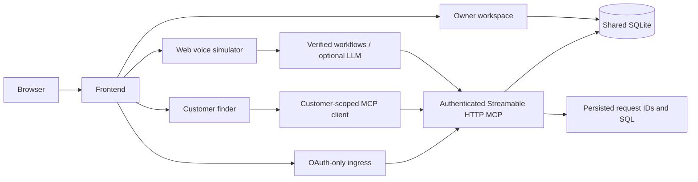

# Architecture and access boundaries

The public landing is the primary entry point. The owner workspace, customer finder and browser simulation share one store-scoped SQLite backend. The simulator and workspace are separate UI clients; the MCP server is an actual protocol service, not a simulated tool-call panel.

Default listeners use loopback. Setup selects available frontend, private backend and OAuth ingress ports and prints URLs. The frontend proxies only restricted owner/customer paths and exact OAuth/MCP routes. The administrator console remains on the backend port. OAuth ingress rejects private API keys and does not mount administrator routes.

## Owner app and inventory

`server/owner.ts`, `owner-auth.ts`, `catalog.ts`, `store.ts`, `photos.ts` and `server/owner/` implement registration, scrypt password authentication, session/CSRF checks, catalog, receiving, POS, reviewed changes, restocks and reports. Each registered business starts empty. Tenant identity comes from its authenticated session/key, never model arguments. Checkout updates the same data used by MCP, rejects overselling and deduplicates retries. Expected counts reject stale edits. Simulated orders do not automatically increase stock; receiving does.

Shelf photos are normalized/stripped with Sharp, marked with an owner-selected arrow and explicitly published. Customers receive pictures only when the store, product and current photo are published. Private files are not a static public directory. Shelf descriptions are written by the owner (or at ingestion time for demo images); there is no runtime AI captioning.

## Voice views and data truth

`simulator/index.ts` serves `/simulator`, `/experience`, `/store/`, `/shop/<slug>` and `/store/admin`. The simulator renders an Echo-style display, tool trace and controls. The guided view selects customer or fictitious owner; PIN `1234` is a synthetic-store walkthrough mechanism only. Real businesses require normal owner authentication.

`simulator/public/handsfree.js` is shared across public voice views. It keeps the mic open, segments on approximately 950 ms pauses, interrupts output and queues the next turn. Any sentence containing the standalone word **stop** disconnects input, clears queued speech, plays goodbye and shows microphone off; `stopping` does not match. The speech providers process utterances, not streaming audio. Physical echo cancellation depends on hardware/browser.

The default demo is deterministic and executes actual MCP/SQLite operations. Live chat can use an optional compatible LLM. Rice/quantity answers use verified inventory rows directly and disclose opening counts when unreconciled. A model cannot approve an order; a fresh explicit approval must match the pending basket. Greetings and role selection are local conversation steps, not fabricated inventory calls.

## MCP and OAuth

`server/index.ts` uses the official MCP SDK's stateless Streamable HTTP transport (2025-11-25). Owner tools read stock/sales, reconcile, update a physical count, prepare/confirm simulated restocks and send configured reports. Customer identities receive only `find_product` through a separate customer server. `server/customer.ts` uses a server-held `customer:read` key for real MCP requests; browser customers never receive that key or stock/cost/sales fields.

`server/oauth.ts` implements S256 PKCE authorization codes, exact registered callbacks, consent/CSRF, scoped resource-bound access tokens, rotating refresh tokens and revocation. Public `/mcp` accepts OAuth tokens only. Store-scoped private keys are a separate internal interface. The consent page currently identifies merchants through a store access key; it is a prototype identity mechanism. Metadata is available at both standard resource discovery forms and authorization-server discovery. A successful OAuth test does not establish native Alexa account/mobile integration.

## Administrator vs judge audit

The local backend `/console/` requires an admin session/key, with a preconfigured synthetic judge dropdown enabled by setup. It can manage stores/keys and inspect calls/errors/latency/SQL. Do not expose this convenience demo login publicly.

`/store/admin` is password/session protected and has an Audit section with tool/SQL and LLM calls. New store owners use the same credentials as the workspace, and every query is bound to that authenticated store. The prefilled Little India reviewer is read-only, synthetic-only and cannot obtain owner mutation permissions. Model prompts/responses, provider/model, errors, timing and conversation IDs are persisted before/after real provider calls; transport authorization headers/keys are never logged. Deterministic quantity answers do not fabricate model records. The old `/audit` redirects to administration, and its old anonymous data API is disabled.

## Main source map

| Source | Purpose |
| --- | --- |
| `setup.py`, `scripts/dev.ts` | OS-aware provisioning and supervised local startup/shutdown |
| `server/config.ts`, `ai-services.ts` | Trusted settings and optional provider adapters |
| `server/index.ts`, `tools.ts`, `auth.ts`, `oauth.ts` | MCP transport, tools, scoped identities and OAuth |
| `server/database.ts`, `store.ts`, `catalog.ts` | SQLite, inventory/POS/business rules and public projection |
| `server/owner*`, `server/owner/` | Owner authentication/workspace |
| `server/customer.ts`, `server/customer/` | Read-only customer web/MCP interface |
| `server/admin.ts`, `server/console/`, `observability.ts` | Private administrator console and persisted audit |
| `server/store-admin.ts`, `server/store-admin/`, `server/model-audit.ts` | Authenticated store audit and exact model request/response records |
| `simulator/agent.ts`, `inventory-query.ts`, `demo-role.ts` | Verified workflows, exact item answers and fictitious role gating |
| `simulator/public/`, `experience/` | Public voice/text views |
| `simulator/landing/` | Main marketing/judge entry and hosted video links |

See [HACKATHON.md](HACKATHON.md) for preview-tool access and honest submission claims. No native Alexa hardware integration, real supplier purchase, payment processing or automatic successful vision caption is asserted.
